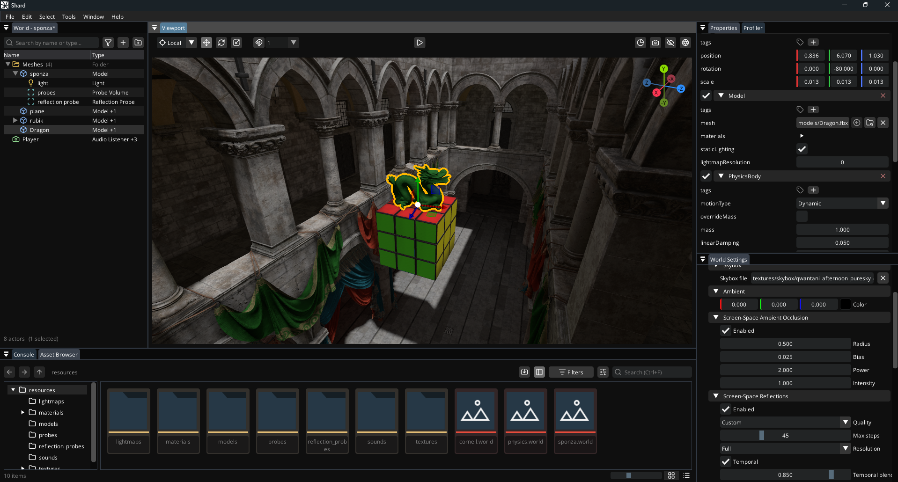
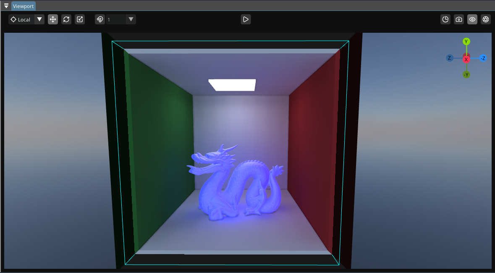
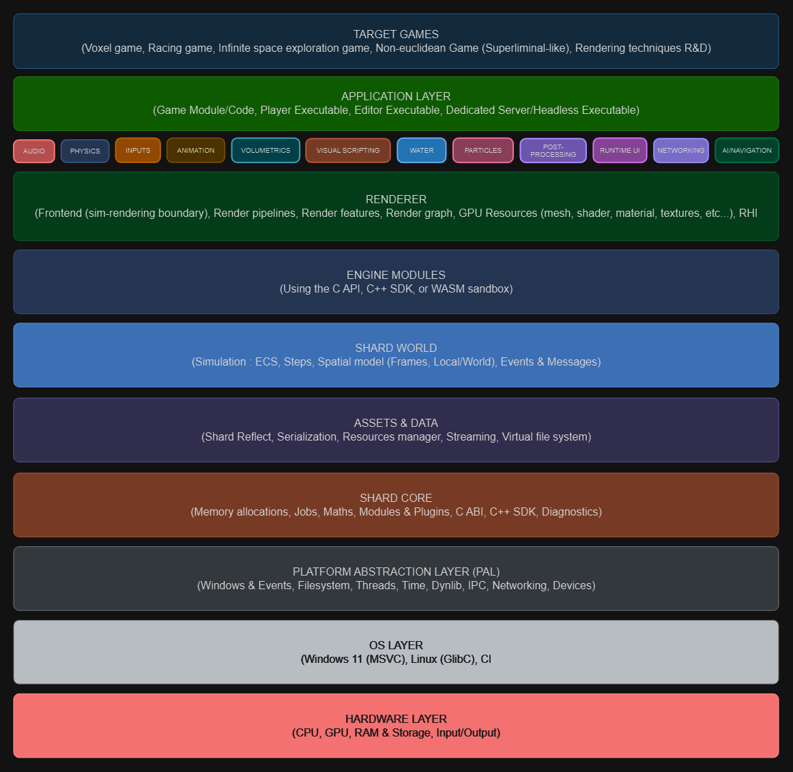

<h1 align="center">Shard Engine</h1>

<p align="center">
  <picture>
    <source media="(prefers-color-scheme: dark)" srcset=".github/ShardLogoWhite.png" width="15%">
    <source media="(prefers-color-scheme: light)" srcset=".github/ShardLogoBlack.png" width="15%">
    
  </picture>
</p>

<p align="center">
  A modular, developper/user friendly, data-oriented game engine<br>
</p>

<p align="center">
  <a href="https://github.com/Windokk/Shard/actions/workflows/build.yml"></a>
  <a href="https://github.com/Windokk/Shard/actions/workflows/build.yml"></a>
</p>

## Screenshots

<div align="center">
  
  <p><i>Path traced render</i></p>
  
  <p><i>View in engine</i></p>
  
  <p><i>Cornell box</i></p>
  
  <p><i>Demo : mini game code</i></p>
</div>

## How to use (Linux)

### Build tools :
- CMake 3.28.2 or later
- A C++17 compiler (GCC or Clang), `make` or `ninja`, git

### Dependencies (Debian / Ubuntu) :
```bash
bash scripts/install_linux_deps.sh
```
This installs what SDL3 needs to build its X11 / Wayland / audio / input backends, plus zlib and liburing (optional, faster async IO). On another distribution install the equivalent packages : see https://wiki.libsdl.org/SDL3/README-linux

### How to build & run :

Clone with the submodules (`git clone --recurse-submodules`, or `git submodule update --init --recursive` afterwards).

Place the fonts (.ttf) inside their folder (resources/editor_resources/fonts/), like on Windows (see below).

Run `./build.sh` (add `Release` for an optimized build). It makes imgui use our vulkan.h, configures, builds everything and starts the editor ; `SHARD_NO_RUN=1 ./build.sh` only builds.

## How to use (Windows)

### Build tools :
- CMake 3.28.2 or later
- C++ 17 Compiler (GCC MinGW recommended)

### Editor Fonts : (Place both in resources/editor_resources/fonts/)
- [OpenSans-Regular.ttf](https://github.com/googlefonts/opensans)
- [lucide.ttf](https://unpkg.com/lucide-static@latest/font/lucide.ttf)


### How to build & run :

Make the imgui submodule use our vulkan.h (src/engine/renderer/rhi/backends/glad/include/glad/vulkan.h) : run `bash scripts/patch_imgui.sh` (from Git Bash / MSYS2)

Place the fonts (.ttf) inside their folder (resources/editor_resources/fonts/)

Run build.bat or build.sh (depending on your OS)

This will compile everything from root : submodules, the engine, the editor, and the game module (loaded with the game app)

SDL3.dll is built with the project and lands in the build folder.

On Linux, SDL3 is built from source and needs the development packages of your window system (X11 / Wayland, ALSA / PulseAudio, libudev ...) : see https://wiki.libsdl.org/SDL3/README-linux

Copy the resources/engine_resources and resources/editor_resources folders inside the build directory

This runs the editor, loads the game module, opens the example project and uses open gl core as the rendering api
```powershell
./ShardEditor.exe --game plugins/game/bin/windows-x86_64/libGameModule.dll --project ..\\example_project\\example_project.json --api opengl
```

## Credits/Dependencies

- Libraries/Projects (git submodules, built with the project) :
  - [SDL3](https://github.com/libsdl-org/SDL) : window, input, clipboard, dialogs
  - [GLM](https://github.com/g-truc/glm) : math
  - [Jolt Physics](https://github.com/jrouwe/JoltPhysics) : physics (built in cross platform deterministic, double precision mode)
  - [ImGui](https://github.com/ocornut/imgui) : editor UI
  - [ImGuizmo](https://github.com/CedricGuillemet/ImGuizmo) : transform gizmos
  - [FreeType](https://github.com/freetype/freetype) : font rasterization
  - [stb](https://github.com/nothings/stb) : `stb_image`, `stb_image_write`, `stb_rect_pack`, `stb_dxt` (texture loading, export, atlas packing, BC1/BC3 compression)
  - [ufbx](https://github.com/ufbx/ufbx) : FBX import
  - [nlohmann/json](https://github.com/nlohmann/json) : JSON
  - [miniaudio](https://github.com/mackron/miniaudio) : audio (with its bundled stb_vorbis)
  - [volk](https://github.com/zeux/volk) : Vulkan loader
  - [Vulkan-Headers](https://github.com/KhronosGroup/Vulkan-Headers) : Vulkan headers
  - [vk-bootstrap](https://github.com/charles-lunarg/vk-bootstrap) : Vulkan instance / device / swapchain setup
  - [Vulkan Memory Allocator](https://github.com/GPUOpen-LibrariesAndSDKs/VulkanMemoryAllocator) : GPU memory allocation
  - [glslang](https://github.com/KhronosGroup/glslang) : GLSL to SPIR-V
  - [SPIRV-Headers](https://github.com/KhronosGroup/SPIRV-Headers) and [SPIRV-Reflect](https://github.com/KhronosGroup/SPIRV-Reflect) : SPIR-V definitions and shader reflection
  - [GoogleTest](https://github.com/google/googletest) : unit tests

- Libraries/Projects (copied into the source tree) :
  - [glad](https://github.com/Dav1dde/glad) : OpenGL / Vulkan function loader (`src/engine/renderer/rhi/backends/glad`)
  - [ImOGuizmo](https://github.com/fknfilewalker/imoguizmo) : view orientation gizmo (`src/apps/editor/gui/imoguizmo.hpp`)
  - [ImGuiNotify](https://github.com/TyomaVader/ImGuiNotify/tree/Dev) : toast notifications (`src/apps/editor/gui/ImGuiNotify.hpp`)
  - [IconFontCppHeaders](https://github.com/juliettef/IconFontCppHeaders) : icon font codepoints

- Downloaded at configure time :
  - [Wasmtime](https://github.com/bytecodealliance/wasmtime) 50 : WebAssembly runtime of sandboxed plugins (prebuilt C API, checked by SHA-256, see `cmake/ShardWasmtime.cmake`)

- Graphics APIs and runtime tools (not shipped) :
  - [OpenGL](https://www.khronos.org/opengl/) 4.6 core and [Vulkan](https://www.vulkan.org/) : rendering backends (the Vulkan loader of the system is loaded at run time)
  - [Slang](https://github.com/shader-slang/slang) (`slangc`, part of the [Vulkan SDK](https://vulkan.lunarg.com/), or set `SHARD_SLANGC`) : compiles the `.slang` shaders

- Build, test and tooling (optional) :
  - [CMake](https://cmake.org/), [Ninja](https://ninja-build.org/), GCC / MinGW-w64 ([MSYS2](https://www.msys2.org/)) or Clang, [Python 3](https://www.python.org/)
  - [LLVM / Clang](https://llvm.org/) and [zlib](https://zlib.net/) : build `ShardReflect`, the reflection generator (skipped when missing)
  - [liburing](https://github.com/axboe/liburing) : faster async IO on Linux (falls back to a thread pool)
  - [lld](https://lld.llvm.org/) (`wasm-ld`) and the [wasi-sdk](https://github.com/WebAssembly/wasi-sdk) 34 sysroot : build the WebAssembly plugins of the tests
  - [Mesa](https://www.mesa3d.org/) (llvmpipe) and [Xvfb](https://www.x.org/wiki/) : software OpenGL on a virtual display, for the CI smoke test
  - [MkDocs Material](https://squidfunk.github.io/mkdocs-material/) and [mkdocs-redirects](https://github.com/mkdocs/mkdocs-redirects) : the documentation website
  - [GitHub Actions](https://github.com/features/actions) (`actions/checkout`, `cache`, `upload-artifact`, `setup-python`, `msys2/setup-msys2`) : CI

- Fonts :
  - [Lucide icons](https://lucide.dev/)
  - [Open Sans](https://fonts.google.com/specimen/Open+Sans)

- Sounds/Music :
  - [TownTheme.mp3](https://opengameart.org/content/town-theme-rpg)
  - [Gun SFX](https://opengameart.org/content/25-cc0-bang-firework-sfx)

- Models :
  - "Rubik's Cube" (<https://skfb.ly/6U7pp>) by RED2000 is licensed under Creative Commons Attribution (<http://creativecommons.org/licenses/by/4.0/>).
  - Intel Sponza 2022 Scene commissioned by Frank Meinl, sponsored by Anton Kaplanyan [Link](https://www.intel.com/content/www/us/en/developer/topic-technology/graphics-processing-research/samples.html)
  - "Cerberus" Gun model [Andrew Maximov](https://artisaverb.info/PBT.html) 
  - "Stanford Dragon (Vrip)" (<https://skfb.ly/BSZn>) by 3D graphics 101 is licensed under Creative Commons Attribution-NonCommercial (<http://creativecommons.org/licenses/by-nc/4.0/>).

- Textures :
  - [Qwantani Afternoon (Pure Sky)](https://polyhaven.com/a/qwantani_afternoon_puresky)

## Philosophy

The engine is a small, strict core meant to be extended. The engine, modules and apps all plug in through the **same public API**. Keep the pieces independent so any of them can be replaced without touching the rest.

> [!NOTE]
> This is the target architecture.
<div align="center"></div>

## Guidelines

1. **Dependencies point down** : a layer only depends on the layers below it.
2. **Peers are decoupled** : Renderer, Physics, Audio, Input never include each other (use ECS components, events or lower-level interfaces).
3. **Everything is a module** : engine, genres and game share one registration API.
4. **Simulation ≠ rendering** : the renderer only consumes an immutable snapshot extracted from the ECS.
5. **Data-oriented + jobs** : archetype ECS, systems with declared read/write access, no ad-hoc threads.
6. **Reflection everywhere** : ShardReflect drives serialization, inspector, replication, undo.
7. **Backends behind interfaces** : RHI, Jolt, miniaudio and SDL3 are replaceable.
8. **Optional determinism** : fixed timestep, seeded RNG, stable system order.
9. **Headless & multi-view** : runs without window/GPU/audio ; N views per frame.
