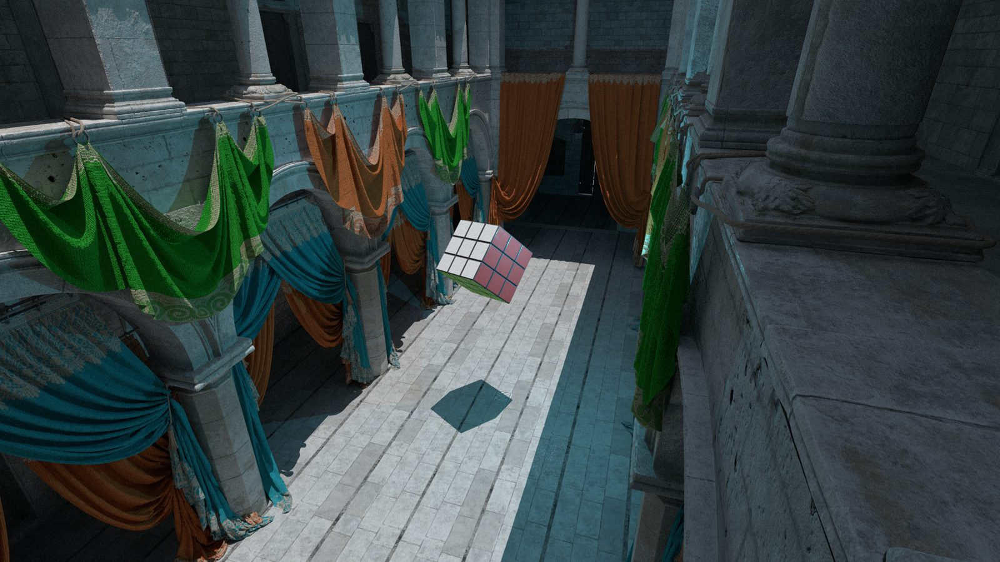
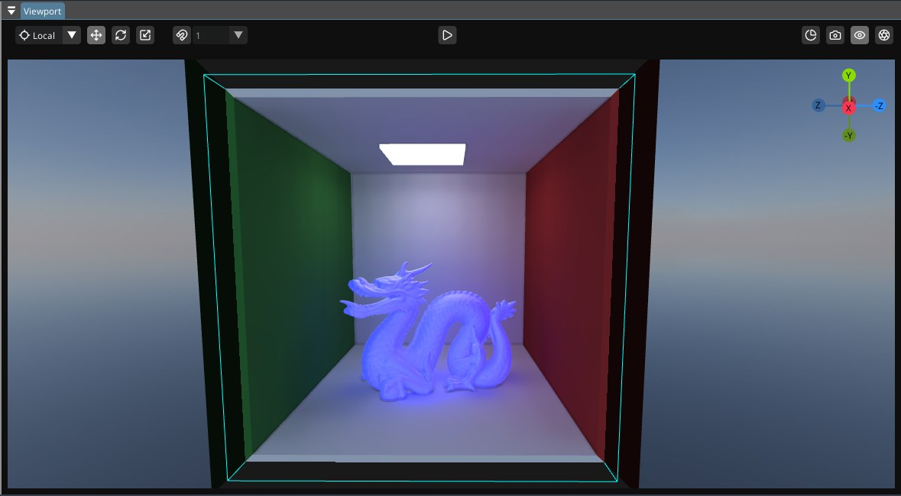

<div class="shard-hero" markdown>

{ .shard-logo }
{ .shard-logo }

# Shard Engine

<p class="shard-tagline" markdown>
A 3D game engine in C++17 for Windows and Linux. It is split into modules (rendering, physics, audio, input), the whole source is open, and a game is written as a plugin.
</p>

[Get started](getting-started.md){ .md-button .md-button--primary }
[Write a game](tutorials/write-a-game-with-the-sdk.md){ .md-button }
[GitHub](https://github.com/Windokk/Shard){ .md-button }

</div>

<figure class="shard-shot" markdown>

<figcaption>Path traced render of a scene from the engine</figcaption>
</figure>

!!! warning "Alpha"
    Shard is in active development. An alpha version is expected in November 2026. Bug reports, feedback and contributions are welcome.

## What it has

| Area | Highlights |
|---|---|
| Rendering | OpenGL 4.6 and Vulkan 1.3 backends, render graph, PBR materials, dynamic lights and shadows, probe-based global illumination, reflection probes, baked lightmaps, path-traced reference renders. See [Renderer](concepts/renderer.md) |
| Physics | Rigid bodies and collisions with [Jolt](https://github.com/jrouwe/JoltPhysics), stepped at a fixed rate |
| Audio | 3D positional audio, reverb zones |
| Input | Keyboard, mouse and gamepads, with dead zones and rumble. Input is recorded in replays |
| Assets | FBX import ([ufbx](https://github.com/ufbx/ufbx)), compressed and cached textures, JSON serialization generated from reflection |
| Editor | ImGui editor with a world tree, gizmos, an inspector, a profiler and hot reload of game code. See [Editor](concepts/executables/editor.md) |
| Plugins | Datapacks without code, native plugins with dependencies, signed packages and registries, and a C ABI that plugins can use with any compiler. See [Plugins and modules](concepts/plugins.md) |
| Simulation | Archetype ECS with systems that declare what they read and write. A fixed timestep and seeded random streams make a run deterministic, and it can run without a window or a GPU. See [Headless mode and determinism](concepts/headless.md) |
| Large worlds | 64-bit coordinates and nested reference frames. See [Large world](concepts/large-world.md) |

## Writing a game

A game is a plugin built with the SDK. A script is a class that lives on an actor, like the engine's own scripts, and each source file registers its own scripts, so a game can be as many files as you like.

=== "health.hpp"

    ```cpp
    #include <shard/game.hpp>

    class Health : public shard::Script {
    public:
        // fields: shown in the inspector, saved with the world, each declared where it is
        SHARD_FIELD(float, maxHealth, Range(1.f, 1000.f)) = 100.f;
        SHARD_FIELD(float, current) = 100.f;
        SHARD_FIELD(shard::Text, label);

        void OnPlay() override { current = maxHealth; }
        void OnTick(float deltaTime) override;
        void Damage(float amount) { current -= amount; }
    };
    ```

=== "health.cpp"

    ```cpp
    #include "health.hpp"

    void Health::OnTick(float)
    {
        if (current <= 0.f) Owner().Destroy();
    }

    // Registers the class
    SHARD_REGISTER_SCRIPT(Health)
    ```

=== "module.cpp"

    ```cpp
    #include <shard/game.hpp>

    // The plugin's entry point, in any one file.
    // Every other file registers its own scripts, components and systems.
    SHARD_GAME_MODULE()
    ```

The [tutorial](tutorials/write-a-game-with-the-sdk.md) goes through it step by step.

<figure class="shard-shot" markdown>

<figcaption>The editor viewport, with probe-based global illumination</figcaption>
</figure>

## Quick start

You need CMake 3.28.2 or later and a C++17 compiler (GCC or Clang on Linux, GCC MinGW on Windows).

```bash
git clone --recurse-submodules https://github.com/Windokk/Shard.git
cd Shard

# Builds the submodules, the engine, the editor and the game module, then starts the editor
./build.sh        # or build.bat on Windows
```

Fonts, resource folders and Linux packages need a few manual steps : see [Getting started](getting-started.md).

## Documentation

- [Getting started](getting-started.md) : build the engine, open the example project, run the tests.
- [Concepts](concepts.md) : how the engine, the renderer, plugins and the simulation work.
- [Tutorials](tutorials.md) : guides that build something that runs.
- [API reference](api_reference.md) : every function of the C ABI.
- [Contributing](contributing.md).

Found a bug ? Open an issue on [GitHub](https://github.com/Windokk/Shard/issues).

Shard is licensed under the GNU GPL v3.0.
